# ResourceSharing
高校教学资源共享平台 亮点：协同过滤推荐、分类偏好补充、教学资源共享闭环、 ECharts教学数据看板、Redis缓存、 多格式在线预览、阿里云OSS文件存储；角色：学生、教师、管理员；

所有源码均本人开发，项目是前后端分离的，所有的项目都具备了完整的业务逻辑，不仅仅局限于基础的增删改查（CRUD）操作，系统亮点众多。

本文注重于计算机毕业设计选题指导，列出题目均有源码， 大家可以去【公众号】(毕业终点站)获取或者加我【qq】(2112698948)提意见(别忘记Star哟)。备注：git

声明：仅用于学习使用，请勿用于任何商业行为！

1.系统非商用，非开源，非无偿。

2.由本人开发，如需源码，请联系以下方式，qq:2112698948。

3.项目有很多，并未全部上传，如果未找到想要的，可直接咨询。

# 高校教学资源共享平台

> 学生前台 + 管理后台（教师 / 管理员）双端协同的教学资源共享系统。教师与学生上传资料，经管理员审核上架，形成浏览、预览、下载、收藏、评论、评分的完整链路；并用协同过滤推荐把对的资源推给对的人。

## 一、系统亮点

- **双路协同过滤推荐**：用户协同（余弦相似度找兴趣相近的人）+ 物品协同（按交互向量找关联资源），在首页和详情页分别做「为你推荐」和「相似资料」。
- **冷启动也能推**：协同推荐不足时，用分类偏好补充、同类资源推荐、热门资源排序三层兜底，新用户一进来就有内容可看。
- **教学资源共享全流程**：上传 → 审核 → 上架 → 预览 / 下载 / 收藏 / 评论 / 评分，教师与学生共建资源库，管理员把控质量。
- **ECharts 教学数据看板**：管理员看平台全局（资源、用户、下载、评论、分类、近 7 天趋势），教师看本人资源表现（分类饼图、趋势、热门柱状图）。
- **多格式在线预览**：Office 文档、PDF、图片、音视频、压缩包目录都能在下载前先看内容，挑资源不踩雷。
- **阿里云 OSS 文件存储**：上传文件 + 限时签名访问链接，教学资源集中管理，不占用业务服务器带宽。
- **Redis 多级缓存**：个性化推荐、相似资源、热门资源、分类、详情都进缓存，业务更新即清理相关缓存，列表和详情加载更快。
- **技术栈较完整**：Spring Boot 3 后端 + uni-app 学生前台 + Vue 3 管理后台，并接入 DeepSeek 接口与 jieba 中文分词做智能处理。

## 二、技术选型

| 层面 | 技术栈 |
| --- | --- |
| 前端（学生前台） | uni-app + Vue 3 + Pinia + uni-ui 组件 |
| 前端（管理后台） | Vue 3 + Vite + Element Plus + ECharts + Pinia + Axios |
| 后端 | Java + Spring Boot 3 + Spring MVC + MyBatis-Plus + MySQL 8 + JWT |
| 实时 / 通信 | WebSocket + SSE |
| 智能与算法 | DeepSeek 接口 + jieba 中文分词 + 协同过滤（余弦相似度） |
| 缓存与存储 | Redis + 阿里云 OSS |
| 环境 / 工具 | JDK 17、Maven、Node.js、微信开发者工具、Windows |

## 三、角色与功能

| 角色 | 核心职责 |
| --- | --- |
| 学生（前台） | 浏览 / 搜索资源、首页个性化推荐、在线预览与下载、收藏夹分类整理、上传资源并查看审核状态、评论与评分 |
| 教师（管理后台） | 工作台数据看板、资源上传与提交审核、我的资源上下架、浏览 / 下载 / 评论记录、查询学生信息 |
| 管理员（管理后台） | 全局数据看板、账号与师生管理、教学资源审核上下架、互动记录（收藏 / 浏览 / 下载 / 评论 / 评分）维护 |

## 四、核心截图

### 系统总览

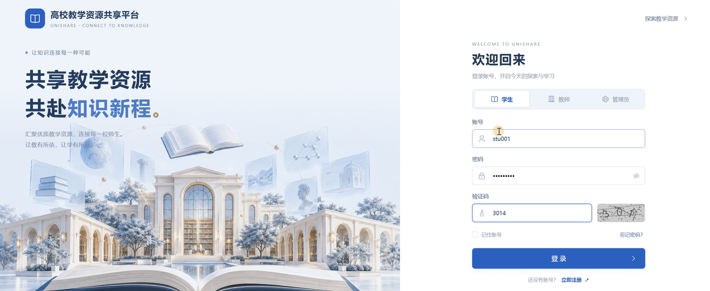

### 学生前台

**① 首页 · 个性化推荐与分类入口**
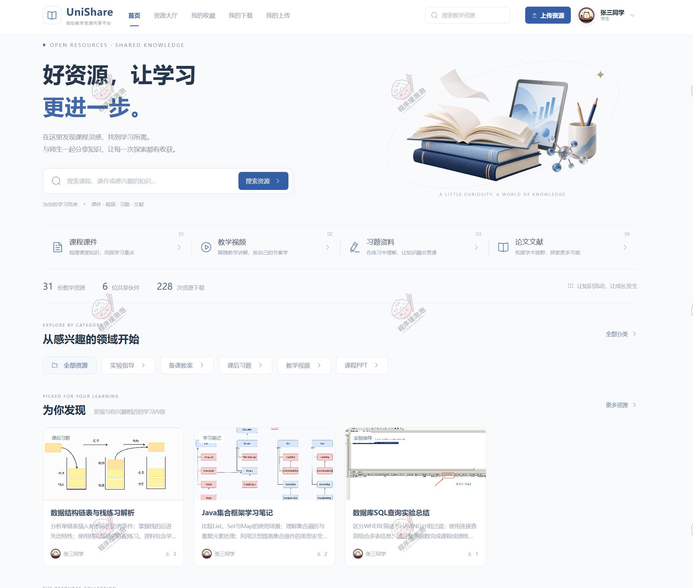

**② 资源大厅 · 搜索与分类筛选**
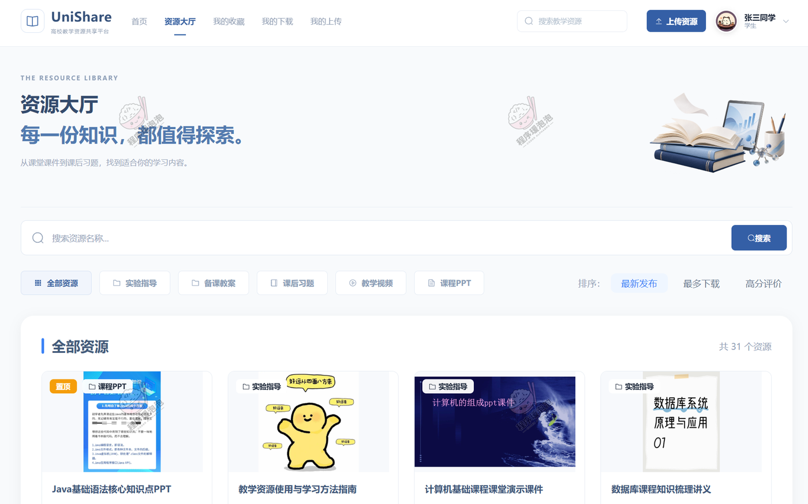

**③ 资源详情 · 相似资源与在线预览**
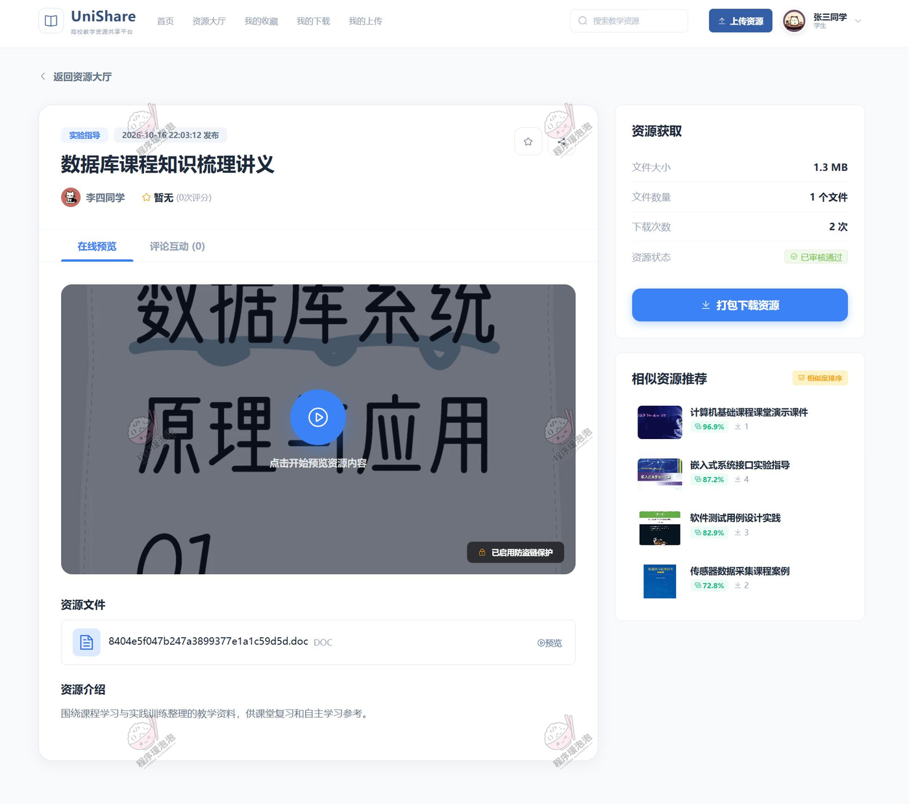

**④ 我的收藏 · 收藏夹分类整理**
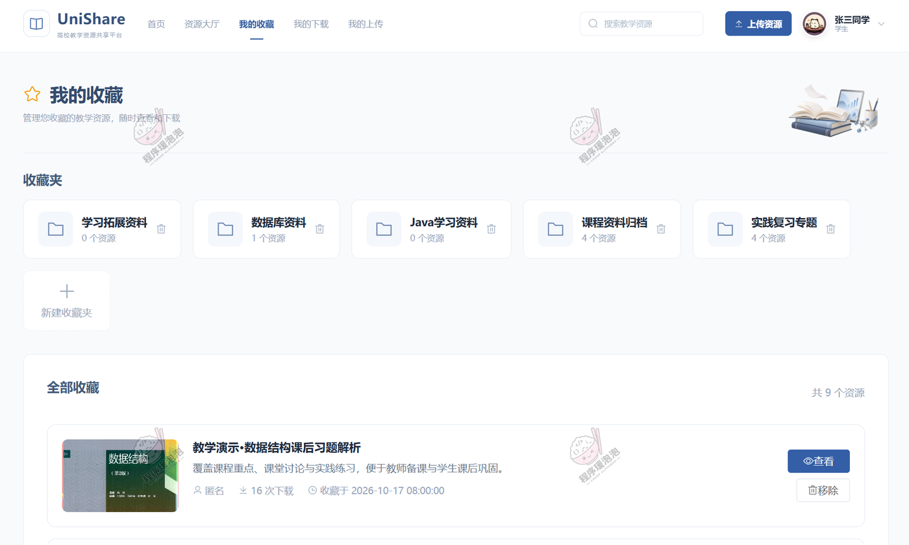

**⑤ 我的下载 · 下载记录回溯**
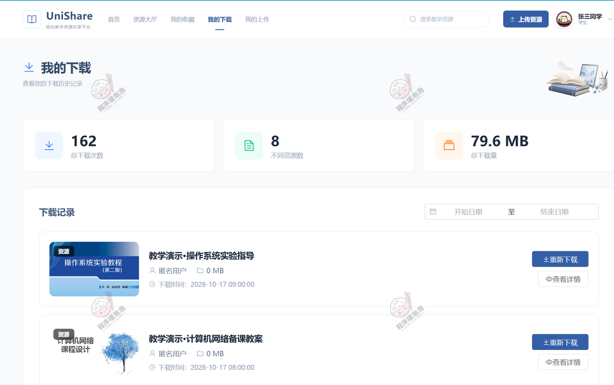

**⑥ 我的上传 · 资源审核状态**
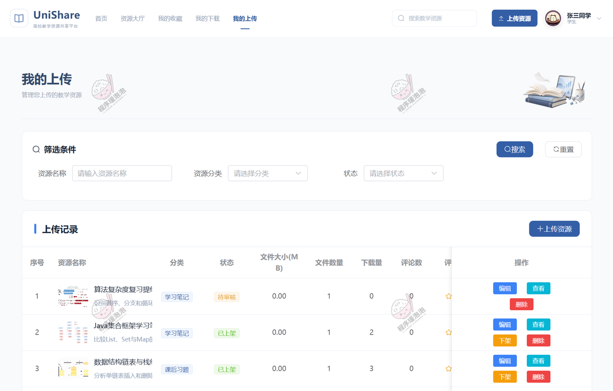

> **首页 / 资源大厅**对应「双路协同过滤」「分类偏好补充」「热门资源排序」——首页给新老用户分别推内容，大厅按名称搜索、按分类筛选并排序；**资源详情**对应「物品协同过滤」「同类资源推荐」「多格式在线预览」；**我的收藏 / 我的下载 / 我的上传**对应「教学资源共享全流程」——收藏夹分类整理、下载记录可回溯、上传后在此查看审核状态。

### 教师端（管理后台）

**① 我的资源（教师工作台）**
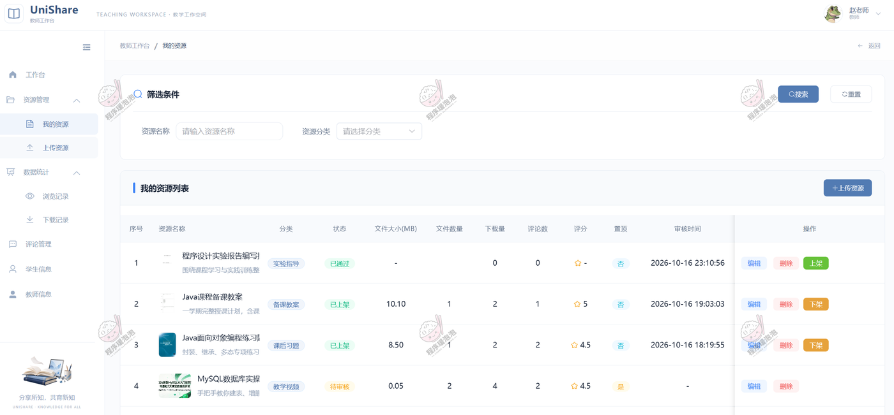

> 查看本人资源的浏览、下载、评论情况，分类饼图 + 近 7 天趋势 + 热门资源柱状图，对应「ECharts 教学数据看板」。

**② 浏览记录**
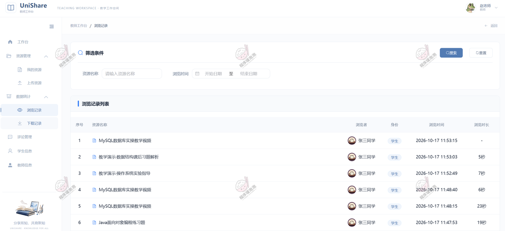

**③ 下载记录**
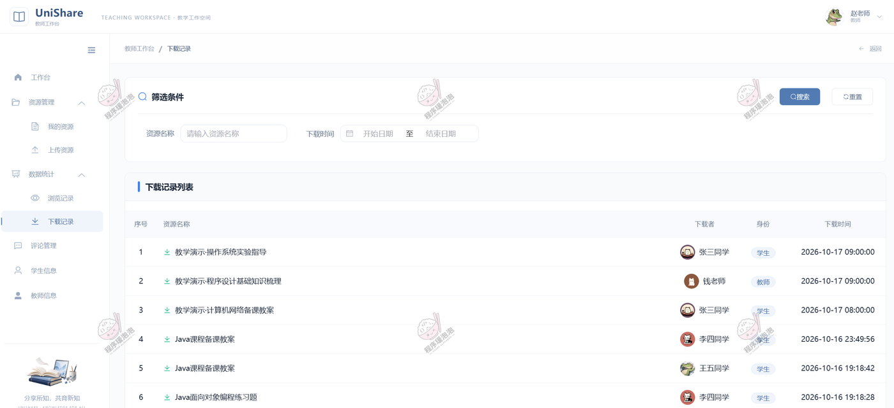

**④ 评论记录**
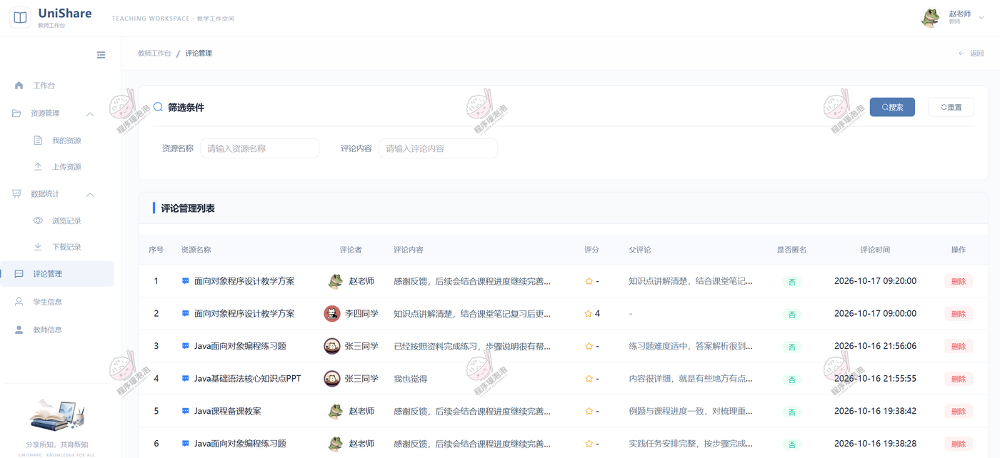

> 浏览 / 下载 / 评论三类记录，配合「我的资源」管理本人上传资料、处理学生互动。

### 管理员端（管理后台）

**① 数据分析（平台数据看板）**
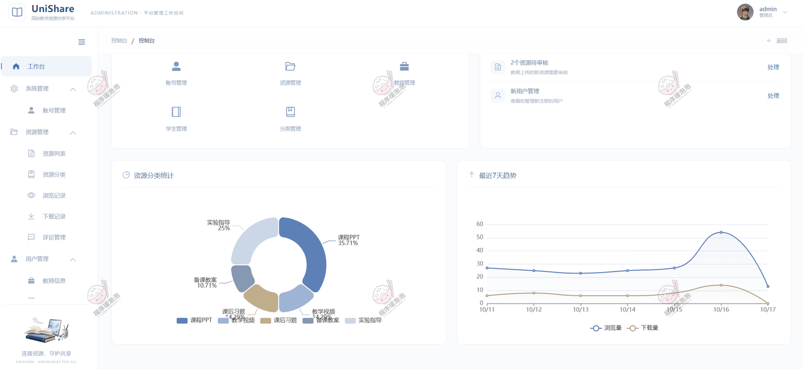

> 资源、用户、累计下载与评论总量，资源分类分布，近 7 天浏览 / 下载趋势，对应「ECharts 教学数据看板」的全局视角。

**② 资讯列表**
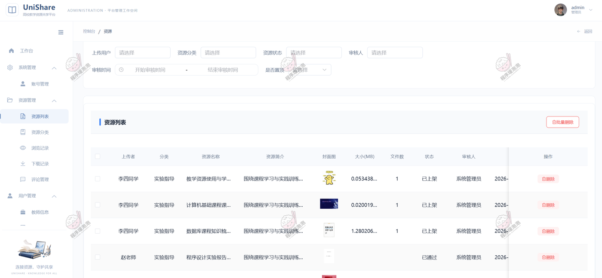

**③ 浏览记录**
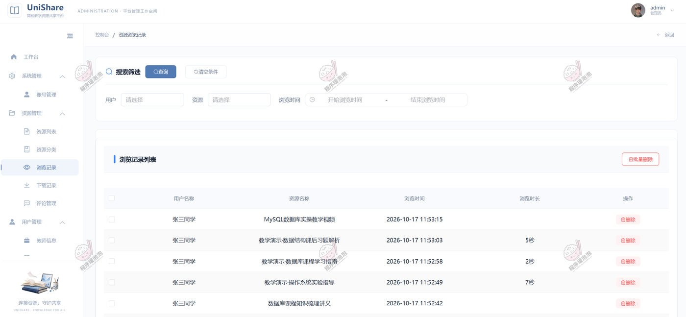

**④ 下载记录**
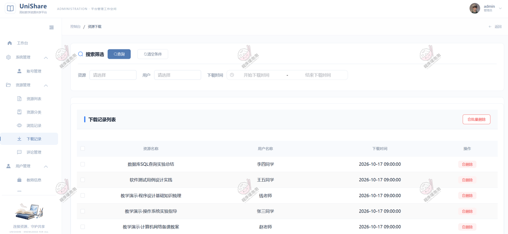

**⑤ 收藏夹**
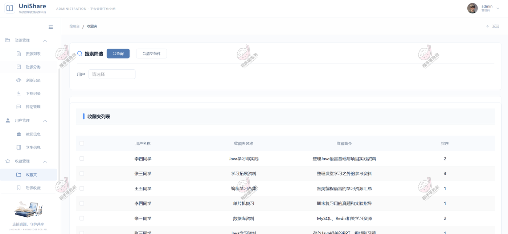

> 管理员通过浏览 / 下载 / 收藏夹等互动记录维护平台活跃数据，并对教学资源执行审核、上下架操作，把住「教学资源共享全流程」的质量关。

---

> 文档展示 16 张截图，需要了解更多，请联系我。
